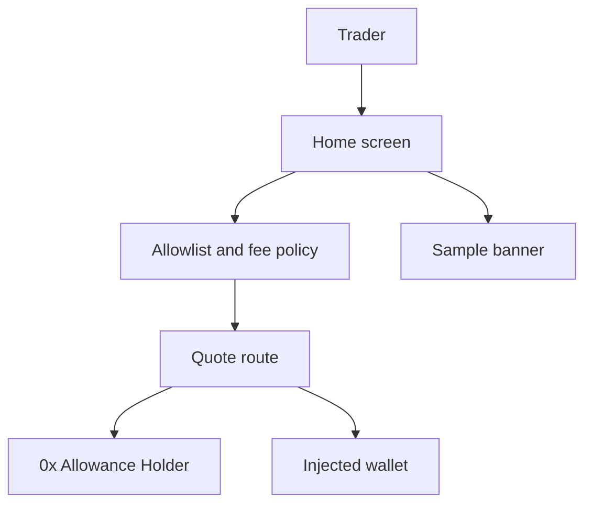
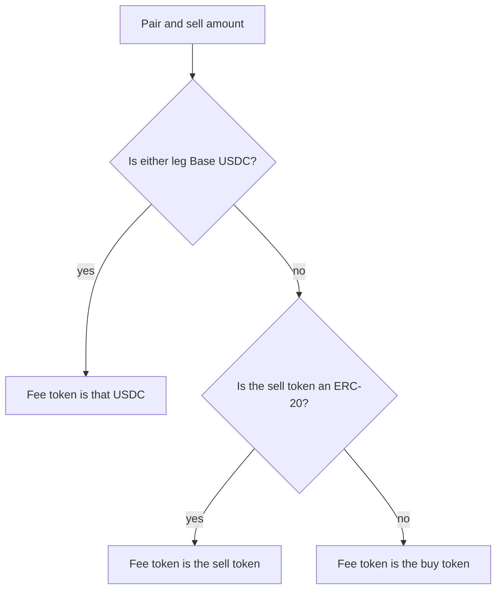
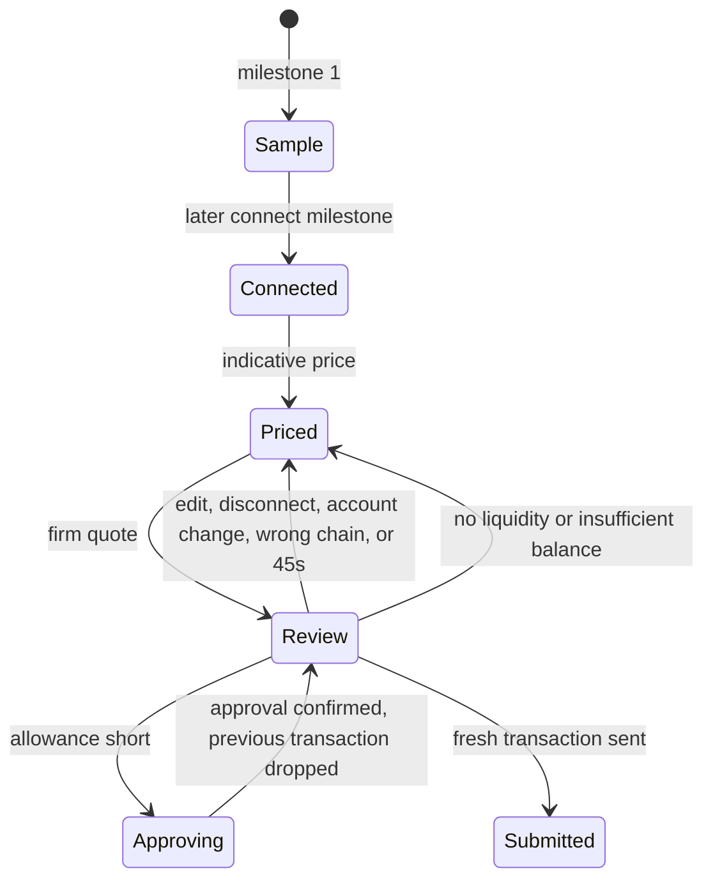

# RomaSwap Base Swap - Plan

## Goal Capsule

- **Objective:** A person opening RomaSwap can read sample Base swap figures and cannot send a wallet transaction or move funds from that screen.
- **Means:** A Next.js mock on a shared allowlist and fee policy, with 0x signing held until the missing policy inputs exist (KTD1, KTD2, KTD6).
- **Authority:** Product behavior lives on the R-IDs. Mechanism lives on the KTDs. Unconfirmed defaults live under Assumptions and stay labeled there. A blocking Open Question stops every unit that cites it.
- **Stop conditions:** This plan does not authorize implementation by itself. The first build, after approval, stops at U1–U3. Do not start U4, U5, or U6 in that build. Do not deploy a contract. Do not call `api.0x.org` from the mock.
- **Execution profile:** Code. Milestone 1 is the mock. Later milestones are specified so the fee and allowlist rules are not reinvented, and they stay gated.
- **Finishes and ships:** After approval, the implementer ships the mock. Live quotes and signing ship only after their blocking questions are answered and that later milestone is approved.

---

## Product Contract

### Summary

RomaSwap is a noncustodial Base swap that will take a 0.25% fee through 0x Swap API v2. The first build is a sample screen. It uses the same allowlist and fee rule the later server will enforce, and it cannot ask a wallet to sign.

### Problem Frame

The repository is an empty initial commit. `AGENTS.md` and `docs/` are not in the tree, so the commission rule, the Trust Wallet fee rule, the token allowlist, and the security requirements named for this product are not written down anywhere the implementer can read. A live swap built from those names alone would have to invent the fee recipient, the token list, and the Trust Wallet difference. The sample screen exists so the product can be reviewed before any of those inventions reach a wallet.

### Key Decisions

- **Sample screen before any signature.** The first ship is a mock that cannot move funds. Governs R7.

### Requirements

**Swap**

- R1. The trader's wallet holds the sell token, signs any approval and the swap, and receives the buy token. RomaSwap does not hold a user key, does not submit the swap, and does not receive the bought tokens.
- R2. Liquidity comes from 0x Swap API v2 on Base, chain id `8453`. RomaSwap does not call a second aggregator and does not call Swap API v1.

**Fee**

- R3. The integrator fee is 0.25% (25 basis points) of the fee token.
- R4. When Base USDC `0x833589fCD6eDb6E08f4c7C32D4f71b54bdA02913` is the sell token or the buy token, the fee is taken in that USDC.
- R5. When that USDC is neither token, the fee is still 0.25% and is taken in one of the two tokens in the pair. Which leg is Assumption A3. The fee is not taken in a third token, and it is not a separate transfer.

**Allowlist and mock**

- R6. A token is allowed only when its checksummed address is on the server allowlist. The sample picker and any later quote route use that list. A matching symbol is not membership. Bridged USDC on Base, `0xd9aAEc86B65D86f6A7B5B1b0c42FFA531710b6CA`, is not Base USDC.
- R7. The first screen is a mock. It does not connect a wallet, request accounts or signatures, submit a transaction, or call 0x. Sample figures stay marked as samples, and that marking cannot be dismissed.

**Boundaries the server keeps**

- R8. RomaSwap does not deploy a settlement, fee-splitter, or allowance contract. The fee is a 0x swap-fee parameter paid to `swapFeeRecipient`.
- R9. The 0x API key stays in server environment. It is not given a public prefix, and no response, error, or log returns it.
- R10. The browser may send a sell token, a buy token, and a sell amount. The server discards a client-supplied chain id, fee recipient, fee rate, fee token, spender, and transaction.
- R11. An approval, when one is required, names only the spender on that quote. RomaSwap does not ask for an allowance to its own address.

**Review**

- R12. A firm quote can be signed only for the connected address, the pair, and the sell amount on screen. Changing the amount, the tokens, or the direction clears it. Disconnecting, switching account, or leaving Base clears it. The transaction fetched before an approval is not the transaction submitted after that approval.
- R13. The typed amount is the sell amount. The server sets slippage. The review shows the minimum buy amount from the firm quote.

### Actors

- A1. Trader, using a browser on desktop or a phone.
- A2. RomaSwap, the Next.js app. It displays the sample in milestone 1 and, later, proxies 0x.
- A3. The trader's wallet. Absent in milestone 1. Later, an injected wallet, including the Trust Wallet extension when EIP-6963 announces `com.trustwallet.app`.
- A4. 0x Swap API. Absent in milestone 1. Later, the only liquidity source.

### Key Flows

- F1. Sample preview
  - **Trigger:** A1 opens the home screen.
  - **Actors:** A1, A2
  - **Steps:** A2 shows a persistent sample banner, the provisional pair, and fixture figures. The primary control stays disabled. No wallet and no 0x call.
  - **Outcome:** A1 can read a sample price and cannot send a transaction.
  - **Covered by:** R7
- F2. Read-only connect
  - **Trigger:** A later milestone, after approval, offers connect.
  - **Actors:** A1, A2, A3
  - **Steps:** A3 connects on Base. If the wallet is on another chain, the only action is to switch to Base. Quote and send stay hidden until the wallet is on `8453`.
  - **Outcome:** A2 knows the address and the chain, and has not requested a quote.
  - **Covered by:** R1, R12
- F3. Indicative price
  - **Trigger:** A1 enters a positive sell amount on an allowlisted pair after live quotes are enabled.
  - **Actors:** A1, A2, A4
  - **Steps:** A2 asks A4 for an indicative price through the server. The fee line names the fee token and the 0.25% rate. A firm quote is not requested while A1 is still typing.
  - **Outcome:** A1 sees a price and a fee, and has not been asked to sign.
  - **Covered by:** R3, R4, R5, R9, R10, R13
- F4. Review, approve, and send
  - **Trigger:** A1 asks to review a trade.
  - **Actors:** A1, A2, A3, A4
  - **Steps:** A2 requests one firm quote for A1's address. A1 sees sell amount, buy amount, minimum buy, fee token, fee amount, Base, and the spender. If an allowance is short, A3 approves that spender for the quoted sell amount. A2 then drops that quote, fetches a new firm quote, and A3 submits that new transaction unchanged. If the new quote still needs allowance, or names a different spender, A2 stops.
  - **Outcome:** The swap either lands in A1's wallet, or A1 is still on review with no second submission.
  - **Covered by:** R1, R11, R12, R13

### Acceptance Examples

- AE1. Sample screen cannot trade
  - **Covers:** R7
  - **Given:** the mock build
  - **When:** A1 opens the home screen and activates every control
  - **Then:** no wallet prompt appears, and the browser does not request `api.0x.org`
- AE2. USDC fee when USDC is a leg
  - **Covers:** R3, R4
  - **Given:** sell token WETH and buy token Base USDC
  - **When:** the fee token is selected
  - **Then:** the fee token is `0x833589fCD6eDb6E08f4c7C32D4f71b54bdA02913` and the rate is 25 basis points
- AE3. Lookalike token
  - **Covers:** R6, R10
  - **Given:** a request whose sell token is bridged USDC `0xd9aAEc86B65D86f6A7B5B1b0c42FFA531710b6CA`
  - **When:** the server handles it
  - **Then:** the response is a refusal, and 0x is not called
- AE4. Stale quote after approval
  - **Covers:** R11, R12
  - **Given:** a firm quote whose allowance is short
  - **When:** the approval transaction confirms
  - **Then:** that quote's transaction is not submitted, and only a newly fetched firm quote can be sent
- AE5. Client fee fields
  - **Covers:** R10
  - **Given:** a body that includes a fee recipient and a chain id other than `8453`
  - **When:** the server builds a 0x request
  - **Then:** those fields are ignored, the chain id is `8453`, and the recipient is the server value

### Success Criteria

- A reviewer can click through the home screen in a browser and confirm AE1, on a phone-width viewport and on a desktop viewport.
- The fee-token and allowlist tests pass without a network call.

### Scope Boundaries

In this plan:

- Base only.
- 0x Swap API v2, Allowance Holder, as the later liquidity path.
- Milestone 1 mock with fixture prices.
- The fee, allowlist, and quote-validity rules, implemented as tested policy before any live call.
- Injected-wallet connect as a later milestone, including the Trust Wallet extension by EIP-6963 `rdns`.

#### Deferred to Follow-Up Work

- WalletConnect, and therefore Trust Wallet mobile, until a WalletConnect project id and app metadata are supplied. The fee does not change when that connector is added.
- A Trust Wallet-specific recipient or rate, until a written rule supplies both the difference and the address.
- Native ETH as an allowlisted asset. The fee function is tested against the native sentinel so a later addition does not invent a second rule.
- Gasless API, Permit2, and a second liquidity source.
- `tradeSurplusRecipient`, source filters, a slippage control, and an exact-buy field.
- Optional 0x response-signature checks.
- Contract deployment of any kind.

Outside the product:

- Custody of user keys or tokens.
- A fee taken by a second transfer, a treasury pull, or a Trust Wallet payment link.
- Chains other than Base.
- Trading from the sample screen.

### Dependencies

- A 0x Dashboard API key, Swap API enabled, before any live call. Not required for U1–U3.
- `SWAP_FEE_RECIPIENT`, a non-zero address the operator controls, before any live call. Not required for the mock, and the mock does not invent one.
- A confirmed allowlist before any live call. U2 may ship the provisional pair in Assumption A1.
- A Base RPC URL before the connect milestone shows balances. Balances are read on Base, not through the wallet's current chain.
- No RomaSwap contract.

### Open Questions

**Blocking**

- Q1. Which tokens are allowlisted, with address, symbol, and decimals, and does the list include native ETH, WETH, or both? Blocks U4 and U6. U2 and U3 use Assumption A1 and label it provisional.
- Q2. What is the `swapFeeRecipient` address? Blocks U4 and U6. A missing or zero recipient means those routes do not call 0x.
- Q3. Does Trust Wallet detection change the recipient, the rate, or only the wallet label? No public Trust Wallet fee API states this. Blocks any differentiated fee. It does not block the single schedule in the Key Decision that governs R3.
- Q4. When neither leg is Base USDC, which leg is the fee token, including a pair where one leg is native ETH? Blocks treating Assumption A3 as confirmed. U2 implements A3 so the branch is tested, and the screen copy says the choice is provisional.

**Deferred to implementation**

- Whether an exact-amount approval makes 0x gas estimation fail. The 0x samples approve the maximum uint256. This plan uses Assumption A6. If estimation fails on a real quote, stop and report it. Do not switch to an unlimited allowance in the same change.
- The firm-quote lifetime on Base. 0x documents about 60 seconds on mainnet and suggests refreshing about every 30 seconds. Assumption A5 uses 45 seconds from arrival. There is no Base-specific figure in the pages fetched.
- Which sentence on the 0x monetize page is the default for an unset `tradeSurplusRecipient`. This plan does not set the field and does not promise surplus to the trader or to RomaSwap.
- Component and function names inside the files listed on each unit.

### Sources

Fetched 2026-10-29 UTC (still 2026-10-28 in Pacific time). Context7 was over its monthly quota, so these are the official pages themselves.

- [Upgrading overview](https://docs.0x.org/docs/upgrading/overview) — Swap API v1 sunset 2025-04-11. v2 is current.
- [getQuote (Allowance Holder)](https://docs.0x.org/api-reference/evm-ap-is/swap/allowanceholder-getquote) — `chainId`, `sellToken`, `buyToken`, `sellAmount` or `buyAmount`, required `taker` on quote, `swapFeeBps`, `swapFeeRecipient`, `swapFeeToken`, `transaction`, `issues.allowance`.
- [Monetize your app](https://docs.0x.org/evm/0x-swap-api/guides/monetize-your-app-using-swap) — fee token must be the buy or sell token. A desired token such as USDC that is not a leg has to be converted by the operator later.
- [Contracts](https://docs.0x.org/docs/core-concepts/contracts) — Allowance Holder is the default for most integrators. Do not hardcode the address. Never approve the Settler.
- [0x FAQ](https://docs.0x.org/docs/introduction/faq) — do not call the API from the browser. RFQ quotes are short-lived on mainnet. Refresh about every 30 seconds.
- [Supported chains](https://docs.0x.org/docs/introduction/supported-chains) — Base `8453`.
- [Handle native tokens](https://docs.0x.org/evm/0x-swap-api/additional-topics/handling-native-tokens) — native sentinel `0xEeeeeEeeeEeEeeEeEeEeeEEEeeeeEeeeeeeeEEeE`.
- [Circle USDC on Base](https://developers.circle.com/stablecoins/usdc-contract-addresses) — native USDC `0x833589fCD6eDb6E08f4c7C32D4f71b54bdA02913`. Bridged USDbC is the address in R6.
- [wagmi SSR](https://wagmi.sh/react/guides/ssr) and [wagmi installation](https://wagmi.sh/react/installation) — wagmi 3 with viem 2, `cookieToInitialState`. npm showed wagmi 3.7.9 and viem 2.57.13 on the fetch date.
- [Trust Wallet extension](https://developer.trustwallet.com/developer/develop-for-trust/browser-extension/evm) — EIP-6963 `rdns` `com.trustwallet.app`.
- [Trust Wallet mobile](https://developer.trustwallet.com/developer/develop-for-trust/mobile) — WalletConnect. No integrator-fee parameter on that page.
- `@0x/swap-ts-sdk` is deprecated. Do not depend on it. RainbowKit's January 2026 maintainer note said wagmi v3 was not supported yet. Do not take that package as the wallet UI.

The local repo contributed no patterns. There is no `docs/solutions/` learning and no `CONCEPTS.md`.

---

## Planning Contract

### Key Technical Decisions

- KTD1. **Use Allowance Holder price and quote on Base.** `GET https://api.0x.org/swap/allowance-holder/price` is indicative. `GET https://api.0x.org/swap/allowance-holder/quote` is the firm quote and requires `taker`. Headers are `0x-api-key` and `0x-version: v2`. Permit2 needs a second signature. Gasless cannot sell native ETH and uses `POST /gasless/submit` instead of a wallet transaction. v1 is sunset. Those three alternatives were concrete in the current docs, so this is a judgment of the docs rather than a prototype comparison. Governs the mechanism for R2.
- KTD2. **The server owns every 0x field except the pair and the sell amount.** A Route Handler adds the key, `chainId=8453`, `swapFeeBps=25`, `swapFeeRecipient` from server environment, and `swapFeeToken` from R4 and Assumption A3. It calls 0x only when the key is present, the recipient is a non-zero address, and live quotes are explicitly enabled. The default is off. The handler is uncached. Governs the mechanism for R9 and R10.
- KTD3. **Approval and custody stay on the quote the user can see.** The spender is `issues.allowance.spender` on that response, and it must match `allowanceTarget` on the same response. It must not be RomaSwap's address or the zero address. Do not hardcode an Allowance Holder address. 0x says the address can change, and using `transaction.to` as the spender can lose funds when that address is the Settler. The buy-token `recipient` is omitted so the buy token defaults to the taker. The fee moves only as `swapFeeRecipient` inside the swap. Governs the mechanism for R1, R8, and R11.
- KTD4. **Submit only a fresh Allowance Holder transaction.** After approval confirms, discard the previous `transaction` and request a new firm quote. Submit `to`, `data`, `value`, and `gas` from that new quote with chain id `8453`. Do not forward `gasPrice`. wagmi treats `gasPrice` as a legacy transaction, and the 0x client samples leave the fee fields to the wallet. Do not rewrite `data`. Ignore a response whose pair, amount, or taker is not the one on screen. Governs the mechanism for R12.
- KTD5. **Connect with wagmi 3 and viem 2, injected wallets first.** `ssr: true`, cookie storage, and `cookieToInitialState` in the server layout. Discover injected providers with EIP-6963. Trust Wallet is `rdns` `com.trustwallet.app`. That label does not change KTD2's fee fields. RainbowKit is not a dependency. WalletConnect waits on the deferred project id. The `chains` list is Base only, imported from `viem/chains`, not retyped. Governs the mechanism for F2.
- KTD6. **The mock bundle does not contain a wallet client or an 0x client.** The home screen does not import wagmi, viem wallet actions, RainbowKit, or AppKit, and it does not fetch `api.0x.org`. The policy modules it does import have no network code. Governs the mechanism for R7.

### Assumptions

These are unconfirmed. Q1–Q4 are the questions that would replace them.

- A1. The provisional allowlist is Base USDC `0x833589fCD6eDb6E08f4c7C32D4f71b54bdA02913` (6 decimals) and Base WETH `0x4200000000000000000000000000000000000006` (18 decimals). Native ETH is not on the list. The sample screen says the list is provisional.
- A2. Every wallet, including Trust Wallet, pays R3's rate to one recipient. Milestone 1 does not detect wallets. The connect milestone does not include WalletConnect.
- A3. Fee token after R4: if the sell token is an ERC-20, use the sell token. If the sell token is the native sentinel, use the buy token, and that buy token must be an allowlisted ERC-20. Never use the native sentinel as `swapFeeToken`. If the 0x response's `fees.integratorFee.token` differs, discard the quote.
- A4. The server sends `slippagePpm=10000` (100 bps, 1%). The review copy says "1% slippage" and shows `minBuyAmount`. There is no slippage control and no buy-amount field.
- A5. A firm quote can be signed for 45 seconds after it arrives. At zero, signing is disabled until the trader asks for a new quote. The app does not auto-submit a refresh.
- A6. The approval amount is the quoted sell amount, not the maximum uint256. Skip the approval when the current allowance already covers that amount. Native sells, if a later allowlist adds them, have no approval and must not use the sentinel as the fee token.
- A7. The sample banner reads "Demo — sample prices, no wallet and no swap." It is not dismissible. Each figure is marked Sample. The primary control is disabled and its label is "Preview only". There is no connect control. The demo is the home screen, not a query flag.
- A8. When the connect milestone shows balances, it reads them with a Base RPC after the wallet is on Base. It does not use the wallet's current chain for `eth_call`.
- A9. There is no price-impact cutoff and no second price source. No route, a zero buy amount, or a 0x error shows "No liquidity for this pair" and hides signing. `tradeSurplusRecipient` is unset.
- A10. shadcn/ui supplies the button, input, and dialog. The app does not add a second component library.
- A11. Fixture arithmetic is fixed in code so tests do not depend on a market. One WETH sample is 2,500 USDC sample. The fee line uses R3, R4, and A3 on those figures and is labeled Sample.

### High-Level Technical Design

Milestone 1 runs the top path only. The lower path is specified and gated. The diagrams cite the owning IDs. They do not add a second rule.



The home screen's only collaborators in milestone 1 are the policy module and the banner. The quote route calls 0x. The wallet only receives a transaction to sign. The wallet does not call 0x. KTD2 and KTD6.



Fee-token choice. R4, then Assumption A3. The native sentinel is never a fee token.



Quote lifecycle for the later milestones. R12 and Assumption A5. The Sample state has no edge to Submitted.

### Sequencing

1. U1, then U2, then U3. That is the first approved build.
2. U5 after a separate approval. It needs no 0x key.
3. U4 after Q1 and Q2 are answered and live quotes are explicitly enabled.
4. U6 after U4 and U5.

U4 and U6 are in this plan so the server boundary is not redesigned during the mock. The stop condition still forbids starting them in the first build.

### Risks and mitigations

- A sample rate can be read as a market. Mitigation is R7 and A7: persistent copy, sample stamps, and a disabled control whose label is not Swap. AE1 checks that no 0x request fires.
- The quote route is a public URL even if only the UI calls it. Mitigation is KTD2: live calls stay off, and client fee fields are discarded. AE3 and AE5 cover the refusal.
- An unlimited Allowance Holder approval would outlive one trade. Assumption A6 keeps the amount at the quoted sell. The deferred question covers the case where estimation fails.
- Trust Wallet's name can be mistaken for a fee rule. A2 keeps one schedule. Q3 blocks a second recipient.
- Firm quotes go stale during an approval. KTD4 fetches a new quote after approval and will not send the old `data`.
- Reading balances on the wallet's current chain can show another network's USDC. A8 reads Base.
- wagmi and viem move quickly. U5 pins the majors named in the sources and does not float to the next major inside the connect milestone.

### Alternatives considered

- Permit2 was rejected for the first signing path because it adds an EIP-712 signature and a calldata append. Allowance Holder is the documented default.
- Gasless was rejected as the default because native sells are unsupported and submission is a relay, not the trader's `sendTransaction`.
- A hardcoded Allowance Holder address was rejected because 0x says the contract address can change after a hardfork.
- RainbowKit was rejected because the current wagmi docs are v3 and the January 2026 RainbowKit note did not claim v3 support.
- Calling 0x from the browser was rejected. The FAQ cites CORS and key exposure.
- Taking the fee as a second token transfer was rejected. That would be a separate signature and a custodial-shaped pull. R8 keeps the fee inside the swap.

---

## Output Structure

Milestone 1 creates the files in U1–U3. The quote, wagmi, and review files are the later shape. The implementer may adjust names. The `**Files:**` list on each unit is the list that matters for that unit.

```text
app/
  layout.tsx
  page.tsx
  globals.css
  api/price/route.ts
  api/quote/route.ts
components/
  swap/mock-swap-panel.tsx
  swap/sample-banner.tsx
  providers/wagmi-provider.tsx
lib/
  tokens/allowlist.ts
  fees/fee-token.ts
  swap/mock-quote.ts
  swap/validate-request.ts
  swap/zeroex.ts
  chain/base.ts
  env.ts
AGENTS.md
README.md
.env.example
```

Tests sit next to the module they cover: `lib/tokens/allowlist.test.ts`, `lib/fees/fee-token.test.ts`, `lib/swap/mock-quote.test.ts`, `lib/swap/validate-request.test.ts`, `lib/swap/zeroex.test.ts`, and `components/swap/mock-swap-panel.test.tsx`.

---

## Implementation Units

### U1. App scaffold

- **Goal:** A Next.js App Router app that builds, with TypeScript, Tailwind, and a test runner, and with no wallet or 0x dependency.
- **Requirements:** R7, R9
- **Dependencies:** none
- **Files:** `package.json`, `app/layout.tsx`, `app/page.tsx`, `app/globals.css`, `README.md`, `AGENTS.md`, `.env.example`, `.gitignore`
- **Approach:**
  1. Use the official Next.js App Router scaffold with TypeScript and Tailwind.
  2. Do not add wagmi, viem, RainbowKit, AppKit, or an 0x SDK in this unit.
  3. `.env.example` names `ZEROX_API_KEY`, `SWAP_FEE_RECIPIENT`, `LIVE_QUOTES_ENABLED`, and `BASE_RPC_URL`, and says the 0x key must not use a public prefix. Values stay empty.
  4. `AGENTS.md` points at this plan and states R1, R7, R8, and R9 in one short list.
  5. README says the app is a sample until a later milestone, and how to install and run the dev server.
- **Patterns to follow:** none in the repo. Follow the scaffold's own layout.
- **Test scenarios:**
  - Test expectation: none — this unit is scaffold and docs. Product behavior starts in U2 and U3.
- **Verification:** The dev server renders a page, the test script exists, and `package.json` does not depend on wagmi, viem, or an 0x client.

### U2. Allowlist and fee policy

- **Goal:** Pure functions decide membership, decimals, and the fee token, with no network access.
- **Requirements:** R3, R4, R5, R6
- **Dependencies:** U1
- **Files:** `lib/tokens/allowlist.ts`, `lib/tokens/allowlist.test.ts`, `lib/fees/fee-token.ts`, `lib/fees/fee-token.test.ts`
- **Approach:**
  1. Store the provisional pair from A1 as checksummed addresses, symbols, and decimals. Export a function that accepts an address and returns the token or a refusal.
  2. Compare by checksummed address. Reject the bridged USDC address in R6, the zero address, and any address not on the list.
  3. Implement R4, then A3, as the fee-token function. Return the token and a flag that the choice is provisional when A3 applied.
  4. Parse a decimal string into base units using the token's decimals. Reject empty input, a leading minus, more fractional digits than the token allows, and more than one decimal point.
  5. Keep this module free of `fetch` and of environment reads.
- **Execution note:** Write the tests before the functions. The later quote route should call these functions rather than re-implement them.
- **Patterns to follow:** none in the repo. Keep the functions free of React.
- **Test scenarios:**
  - Happy path: Base USDC and Base WETH are members. A WETH-to-USDC pair selects Base USDC as the fee token at 25 basis points.
  - Happy path: a lowercase Base USDC address matches the checksummed entry.
  - Edge: a pair of two non-USDC ERC-20 fixtures, used only inside the test, selects the sell token and marks the choice provisional.
  - Edge: a sell token equal to the native sentinel, with an allowlisted ERC-20 buy token, selects the buy token and does not select the sentinel.
  - Error: bridged USDC `0xd9aAEc86B65D86f6A7B5B1b0c42FFA531710b6CA` is not a member.
  - Error: the same address on both sides is rejected by the pair check.
  - Error: `"1.2"` for USDC (6 decimals) is accepted as `1200000` base units, and `"1.2345678"` is rejected.
  - Error: `""`, `"0"`, `"-1"`, and `"1e6"` are rejected.
- **Verification:** The test file passes with no network. The fee-token module does not import a server or a wallet client.

### U3. Phase 1 mock swap screen

- **Goal:** The home screen shows a sample Base swap, uses U2 for the pair and the fee, and cannot be used to sign or to fetch a live price.
- **Requirements:** R3, R4, R6, R7
- **Dependencies:** U1, U2
- **Files:** `app/page.tsx`, `components/swap/mock-swap-panel.tsx`, `components/swap/mock-swap-panel.test.tsx`, `components/swap/sample-banner.tsx`, `lib/swap/mock-quote.ts`, `lib/swap/mock-quote.test.ts`, `components/ui/` for the shadcn button and input
- **Approach:**
  1. The home screen is a single column on a phone and a centered column on a wide viewport. The banner from A7 sits above the panel and has no close control.
  2. The picker offers only A1's two tokens. Choosing a token on one side removes it from the other side. Direction can flip.
  3. Empty or invalid amounts show "Enter an amount" and no buy figure. A valid amount shows the A11 fixture conversion, a Sample stamp, the fee rate from R3, the fee token from U2, and a sample fee amount.
  4. The primary control is disabled. Its accessible name is "Preview only". It does not say Swap.
  5. Do not render a connect button, a chain switch, or a transaction hash. Do not import the modules KTD6 forbids.
  6. Copy states the list and the fee are samples, and that funds stay in the wallet on a later release.
- **Execution note:** After the component tests, open the dev server and click the disabled control, flip the pair, and enter an over-precise amount. Confirm AE1 in the browser network panel on a narrow viewport and a wide one.
- **Patterns to follow:** U2's fee-token function. Do not duplicate the fee rule in the component.
- **Test scenarios:**
  - Happy path: rendering the panel shows the A7 banner, both provisional tokens, and a disabled "Preview only" control.
  - Happy path: entering `1` with WETH as the sell token and USDC as the buy token shows a sample buy amount of 2,500 USDC and a sample fee in USDC.
  - Happy path: flipping the pair changes which token is sold and recalculates the sample from U2.
  - Edge: an empty amount shows "Enter an amount" and hides the buy figure.
  - Edge: `1.2345678` USDC shows a validation error and no buy figure.
  - Error: the panel's module graph does not import wagmi, viem, or a fetch to `api.0x.org`. A test that inspects the imported graph, or a render test that fails if `fetch` is called, covers this.
  - Integration: the fee line for a USDC leg matches `fee-token` for the same pair. The component does not contain a second fee-token table.
- **Verification:** AE1 holds in the browser. The component tests pass. The disabled control never becomes enabled in this unit.

### U4. Quote boundary, live calls off

- **Goal:** A server boundary that refuses every quote until Q1, Q2, and the live-quote switch are satisfied, and that will call 0x only with KTD2's fields.
- **Requirements:** R2, R6, R9, R10, AE3, AE5
- **Dependencies:** U2. Blocked by Q1 and Q2. Not part of the first build.
- **Files:** `app/api/price/route.ts`, `app/api/quote/route.ts`, `lib/swap/validate-request.ts`, `lib/swap/validate-request.test.ts`, `lib/swap/zeroex.ts`, `lib/swap/zeroex.test.ts`, `lib/env.ts`
- **Approach:**
  1. Validate the body with U2. Refuse equal tokens, unknown addresses, and amounts U2 rejects. Do not call 0x on a refusal.
  2. Ignore client `chainId`, `swapFeeRecipient`, `swapFeeBps`, `swapFeeToken`, `taker` on the price route, and any transaction object.
  3. Build the 0x query from KTD1 and KTD2. The quote route sets `taker` from the connected address the server was given by the later wallet session, not from an unchecked body field, once U6 exists. Until then the quote route stays disabled with the price route.
  4. If the key is missing, the recipient is missing or zero, or `LIVE_QUOTES_ENABLED` is not the enabled value, respond with a refusal and do not call 0x.
  5. Do not cache the handlers. Do not log the API key.
- **Execution note:** Tests use a stub transport. No test hits `api.0x.org`.
- **Patterns to follow:** U2 for membership and the fee token.
- **Test scenarios:**
  - Happy path: with the key, a non-zero recipient, and live quotes enabled, a USDC-to-WETH sell amount produces a query whose `chainId` is `8453`, `swapFeeBps` is `25`, `swapFeeToken` is Base USDC, and the header carries the key. The stub sees that query and the client response does not contain the key.
  - Edge: the same request with `LIVE_QUOTES_ENABLED` unset does not call the stub.
  - Error: bridged USDC as the sell token returns a refusal and does not call the stub. Covers AE3.
  - Error: a body that sets `swapFeeRecipient` and `chainId` to `1` still produces `8453` and the server recipient. Covers AE5.
  - Error: a zero recipient does not call the stub.
  - Integration: the fee token on the query matches U2 for a non-USDC fixture pair, and a response whose `fees.integratorFee.token` differs is discarded per A3.
- **Verification:** Stub tests pass with live quotes off by default. A search of the client components shows they do not import `lib/env.ts`.

### U5. Base wallet session

- **Goal:** An injected wallet can connect, and the app can see that it is on Base, without requesting a quote or a signature.
- **Requirements:** F2, KTD5, A2, A8
- **Dependencies:** U1. Not part of the first build. Do not import this provider from the milestone-1 home screen.
- **Files:** `app/(wallet)/layout.tsx`, `app/(wallet)/connect/page.tsx`, `components/providers/wagmi-provider.tsx`, `lib/chain/base.ts`, `components/swap/connect-button.tsx`, `components/swap/connect-button.test.tsx`
- **Approach:**
  1. Add wagmi 3 and viem 2 at the majors in the sources. Configure cookie storage and pass `cookieToInitialState` from `app/(wallet)/layout.tsx`. Do not add the provider to the root layout. The home route must keep the bundle KTD6 describes.
  2. The chain list is viem's Base export only.
  3. Use the injected connector with EIP-6963 discovery. Show the announced name. When `rdns` is `com.trustwallet.app`, the label may say Trust Wallet. The label is not passed to the fee functions.
  4. When the chain is not `8453`, the only action is to switch to Base. Refusing the switch leaves quote and send hidden.
  5. Do not add WalletConnect in this unit.
  6. Load the connect control with a client-only dynamic import inside the wallet route group.
- **Patterns to follow:** wagmi's SSR guide. KTD5.
- **Test scenarios:**
  - Happy path: a mocked injected provider on chain `8453` shows a shortened address and the wallet name, and does not call the price route.
  - Happy path: an announcement with `rdns` `com.trustwallet.app` shows Trust Wallet, and the rendered output contains no fee recipient.
  - Edge: a provider on chain `1` shows a switch-to-Base control and no quote control.
  - Error: declining the switch leaves the quote control absent.
  - Integration: the milestone-1 page module does not import `wagmi-provider`.
- **Verification:** The connect tests pass without a live wallet. The home page from U3 still satisfies AE1 after this unit is added, because the home page does not mount the provider.

### U6. Review and submit

- **Goal:** A trader can review a firm quote and submit only a fresh Allowance Holder transaction from their wallet.
- **Requirements:** R1, R11, R12, R13, F4, AE4
- **Dependencies:** U4, U5. Blocked by Q1 and Q2. Not part of the first build.
- **Files:** `components/swap/review-panel.tsx`, `components/swap/review-panel.test.tsx`, `lib/swap/quote-session.ts`, `lib/swap/quote-session.test.ts`
- **Approach:**
  1. Indicative prices may update while the trader types. Debounce them. Ignore a response that does not match the latest pair, amount, and taker.
  2. A firm quote is requested only from an explicit review action. Start the A5 timer. Show sell amount, buy amount, `minBuyAmount`, the fee token, `fees.integratorFee.amount`, the rate from R3, the word Base, and the spender.
  3. Hide review when the Base sell balance is below the sell amount, or when 0x reports `issues.balance`. Copy: "Insufficient balance." When the sell token is an ERC-20 and the Base ETH balance cannot cover the quote's network fee, copy: "Not enough ETH on Base for gas." Do not open an approval in either case.
  4. If allowance is short, send an approval for A6's amount to KTD3's spender. On confirmation, drop the old transaction, request a new firm quote, and submit only that transaction's `to`, `data`, `value`, and `gas` per KTD4. If the new quote still needs allowance or names another spender, stop.
  5. Any edit, flip, disconnect, account change, or chain change clears the signable transaction immediately.
  6. After submit, show pending, then the Base transaction hash, or a revert message. A rejected signature returns to review while the timer is running. An expiry or slippage revert offers a new quote and does not resubmit. Disable the sign control after it is pressed.
- **Patterns to follow:** KTD3 and KTD4. U4 for the request. U5 for the account and chain.
- **Test scenarios:**
  - Happy path: a quote with a null allowance issue enables submit, and the submitted object matches that quote's `to`, `data`, `value`, and `gas`, with chain id `8453` and without `gasPrice`.
  - Happy path: a short allowance submits an approval for the quoted sell amount to `issues.allowance.spender`, then a second quote, and submits only the second transaction. Covers AE4.
  - Edge: at 45 seconds the sign control disables and a refresh is explicit.
  - Edge: changing the amount clears `data` before the timer ends.
  - Error: a quote whose spender differs from `allowanceTarget` does not open a wallet.
  - Error: `issues.balance` shows "Insufficient balance" and does not approve.
  - Error: a second click does not submit twice.
  - Integration: an account change while review is open clears the transaction and does not leave the previous `data` in component state.
- **Verification:** Session tests pass with a stub wallet. No test broadcasts. AE4 is covered by the approval scenario.

---

## Verification Contract

The scaffold in U1 adds these scripts. Commands are the contract for later execution, not a step in planning.

- `npm test` runs the unit tests named on U2–U6. Milestone 1 is done when the U2 and U3 tests pass.
- `npm run lint` passes on the files those units add.
- `npm run build` completes for the milestone that is being shipped.
- Milestone 1 browser check: load the home screen, confirm AE1 on a narrow viewport and a wide viewport, and confirm the network panel has no request to `api.0x.org`.
- U4 is not verified against production 0x. The stub tests are the gate until Q1, Q2, and an explicit live-quote switch are done.
- U6 is not verified by a mainnet trade in this plan.

---

## Definition of Done

Milestone 1 is done when:

- U1–U3 meet their verification lines.
- The home screen matches A7 and AE1.
- The fee and allowlist tests encode R3, R4, R6, and A3.
- `package.json` for that milestone does not depend on wagmi, viem, or an 0x SDK.
- Abandoned experiments are not left in the diff.

The later milestones are done only when their own units meet their verification lines, Q1 and Q2 are answered for U4 and U6, and that milestone was approved separately. A live trade on Base is not a completion condition of this plan.

---

## System-Wide Impact

- The price and quote routes will be public HTTP endpoints. Their protection is KTD2 and U2, not the hope that only the UI calls them.
- Wallet state is cookie-hydrated only in the connect milestone. The mock must not read `localStorage` to invent a session.
- Fee parameters and the allowlist are server state. A client copy of the fee rate is display only.
- No database, no session store, and no background job are introduced.
- Logging must not include the API key. A later live route should not log full transaction `data`.
