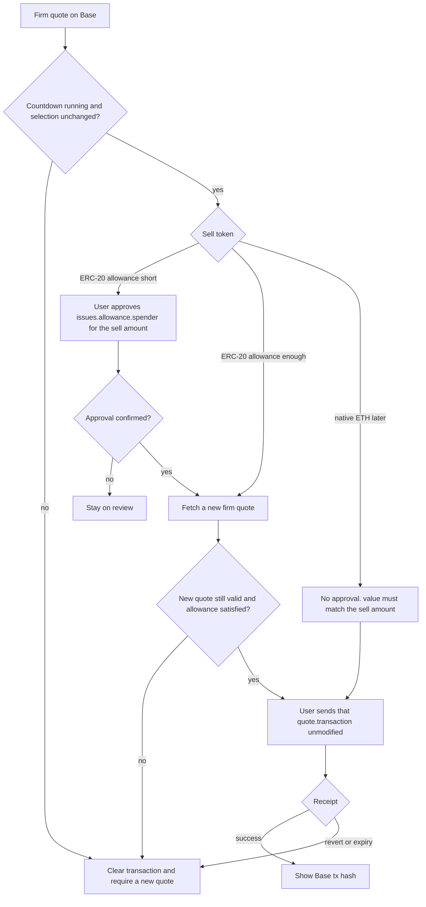

# Spec flow: RomaSwap

Phase 1 found no existing flows: `/workspace` has only the "Initialize project" commit, with no `AGENTS.md`, no `docs/`, and no source, so this analysis uses no repo patterns.

RomaSwap is a noncustodial Base (chain 8453) swap. The user picks two allowlisted tokens and an amount, sees a price, reviews a 0.25% integrator fee, and later signs in their own wallet. The app never holds keys or tokens. Liquidity is only 0x Swap API v2 Allowance Holder, called from a Next.js server route so the browser never sees the API key. The server sets `swapFeeBps=25`, pins `swapFeeRecipient`, and sets `swapFeeToken` to the buy or sell token. If Base USDC (`0x833589fCD6eDb6E08f4c7C32D4f71b54bdA02913`) is one leg, that USDC is the fee token. If neither leg is USDC, the fee is an allowlisted leg and is disclosed. 0x cannot fee a third token. No contract is deployed.

Phases in the spec: (1) a labeled mock with fixture prices and no wagmi, wallet prompts, or 0x calls; (2) read-only wallet connect on Base only; (3) indicative price and firm quote through the server; (4) the user approves only `issues.allowance.spender` and sends `quote.transaction` unmodified.

## User Flows

### 1. Phase 1 sample preview

- **Entry:** The user opens the app.
- **Decisions:** Which two tokens, and what amount.
- **Happy path:** The screen shows a fixture price and a 0.25% fee line. The user can see which token the sample fee is denominated in. Nothing is signed and no request leaves the browser for 0x or a wallet.
- **Terminal:** The user leaves, or waits for a later phase. There is no success transaction.

### 2. Connect a wallet, read-only, Base only

- **Entry:** A connect control in phase 2. Phase 1 has no connect control.
- **Decisions:** A wallet is present or not. The user accepts or rejects the connection. The selected account is on chain 8453 or on some other chain. The user may later disconnect or switch accounts.
- **Happy path:** The app shows the connected address, the wallet label, and that the network is Base. It does not ask for a signature, an approval, or a swap.
- **Terminal:** Connected on Base; connection rejected; no injected wallet; or connected on the wrong chain and blocked from quoting.

### 3. Indicative price and fee disclosure

- **Entry:** Phase 3, wallet already connected on Base, two distinct allowlisted tokens, a positive sell amount.
- **Decisions:** The server chooses the fee token (USDC if either leg is Base USDC; otherwise an allowlisted leg). The price route either returns a route or it does not.
- **Happy path:** The user sees an indicative rate, the fee rate (0.25%), the fee token, and the fee amount reported by 0x. This screen is not yet signable.
- **Terminal:** An indicative price is shown; the pair is rejected locally; the amount is unusable; or 0x has no route.

### 4. Firm quote review

- **Entry:** The user asks to review a trade after flow 3.
- **Decisions:** Accept the firm numbers, edit the amount or tokens, wait, disconnect, or switch account or chain.
- **Happy path:** The server requests `/swap/allowance-holder/quote` with the connected address as `taker`, `chainId=8453`, and the pinned fee fields. The review shows the firm sell amount, firm buy amount, minimum received, 1% slippage, fee token, and fee amount, plus a short countdown. The signable transaction stays in memory only.
- **Terminal:** The user continues to flow 5; the quote expires; the user edits or disconnects and the transaction is dropped; or the quote is discarded because fee, chain, or liquidity checks failed.

### 5. Approve the spender and send the quoted transaction

- **Entry:** A firm quote that is still inside its countdown, for the connected taker, on Base.
- **Decisions:** Sell token is an ERC-20 that still needs allowance, an ERC-20 that is already allowed, or (only if the allowlist later includes it) native ETH. The user confirms or rejects each wallet prompt.
- **Happy path, ERC-20:** The review explains that the first prompt is an approval for `issues.allowance.spender` for the quoted sell amount. After that approval is confirmed, the app drops the old transaction, fetches a new firm quote, and asks the user to send only that new `quote.transaction` with `to`, `data`, and `value` unchanged. The app then shows pending, then the Base transaction hash, or a revert.
- **Happy path, allowance already sufficient:** One prompt, the fresh quote's transaction, then the same receipt states.
- **Terminal:** Success with a hash; approval rejected; swap signature rejected; quote expired before send; approval confirmed but the replacement quote still reports an allowance gap; transaction reverts; user disconnected or changed the trade before send.

### 6. Direct call into the price or quote route

- **Entry:** A browser session, a modified client, or any HTTP client hits the Next.js route with its own query.
- **Decisions:** Tokens are both on the allowlist, or one of them is a lookalike, a same-token pair, or an unknown address. Fee fields may be present on the request.
- **Happy path:** Allowlisted, distinct tokens are priced or quoted with server-pinned fee fields only.
- **Terminal:** Anything else is a 400 and 0x is not called. The route never returns the API key.

## Gaps

### Critical

**1. The mock can be mistaken for a live swap**

The spec says phase 1 is a labeled mock with fixture prices and no wagmi, wallet prompts, or 0x calls. It does not say where the label lives, whether it can be dismissed, or what the primary button does. A realistic rate and a button that says Swap will make people believe a trade is available or already done. No existing pattern covers this. Default: a persistent banner, "Demo — sample prices, no wallet and no swap." Each figure is marked Sample. The primary control is disabled and does not say Swap. There is no connect button. The demo is its own route or a build-time phase, not a query param or a toast.

**2. The allowlist is unknown, and the server can be used as an open proxy**

Members, decimals, and symbols were not supplied. The only concrete token is Base USDC. Bridged USDC on Base (`0xd9aAEc86B65D86f6A7B5B1b0c42FFA531710b6CA`) and any other same-symbol contract are lookalikes. A route that forwards client `sellToken` / `buyToken` to `https://api.0x.org/swap/allowance-holder/price` or `/quote` will price them. No existing validation pattern exists. Default: identity is the checksummed address. The server calls 0x only when both legs are on the server allowlist and are different. Client `swapFeeBps`, `swapFeeRecipient`, `swapFeeToken`, and `chainId` are ignored. Production uses `chainId=8453`, `swapFeeBps=25`, and the env recipient. Live price and quote work stays out of the plan until the list and recipient exist. The mock may fixture Base USDC (6 decimals) and Base WETH `0x4200000000000000000000000000000000000006` (18 decimals) with sample prices only.

**3. The fee recipient was not supplied, and nothing on-chain will be deployed to hold it**

`swapFeeRecipient` must be pinned on the server. There is no public Trust fee API, no supplied address, and no fee-splitter deployment in scope. A blank recipient, the zero address, or a client-supplied recipient either fails the quote or diverts the 0.25%. No existing config pattern exists. Default: if the recipient env is missing or zero, the price and quote routes refuse to call 0x. The mock shows the 0.25% rate and a sample fee amount, and it does not invent a recipient address.

**4. Trust Wallet detection has no fee rule**

Detection is EIP-6963 `rdns` `com.trustwallet.app` or WalletConnect. No recipient, rate, or detection-to-recipient rule was supplied, and 0x cannot fee a third token, so a second fee cannot be taken in a separate Trust token. Implementing detection now adds a hook that later code can wire to a different recipient without a product rule. WalletConnect also needs a project id and app metadata that were not supplied. Trust's mobile users usually arrive through WalletConnect, not the extension. No existing wallet layer exists. Default: every wallet pays 25 bps to the same pinned recipient. Phase 1 does not detect wallets. Phase 2 is injected EIP-6963 only, including the Trust extension, and the label does not change fee params. WalletConnect stays out of this plan.

**5. The fee token is unspecified when neither leg is USDC, and native ETH is not a safe fee token**

USDC-first is specified. The other branch only says "an allowlisted leg" that is disclosed. 0x will reject a fee token that is not the buy or sell token. Treating native ETH (`0xEeeeeEeeeEeEeeEeEeEeeEEEeeeeEeeeeeeeEEeE`) as `swapFeeToken` is not supported by this spec and must not be assumed. If the server hardcodes "fee is always USDC," the first non-USDC pair is wrong. No existing fee helper exists. Default: fee token is Base USDC when either leg is that address. Otherwise it is the sell token when the sell token is an ERC-20. If the sell token is native ETH, the fee token is the buy token, and that buy token must be an allowlisted ERC-20. The review shows the symbol and the `fees.integratorFee` amount from 0x, not a client-side recompute. A response whose fee token differs from the server's choice is discarded.

**6. Allowance, a 30–60 second quote, and edits or disconnects cannot share one transaction**

The spec's execution line is: approve `issues.allowance.spender`, then send `quote.transaction` unmodified. An approval prompt plus a Base confirmation usually outlives a firm quote, and 0x may not return an explicit expiry time. Sending the pre-approval transaction after it expires reverts or submits a stale trade. The same transaction becomes wrong if the user edits the amount, flips the pair, disconnects, switches account, or leaves Base during review. No existing quote state machine exists. Default: a 45-second timer starts when a firm quote arrives; at zero, signing is disabled and a new quote is explicit, never automatic. Any edit, disconnect, `accountsChanged`, or chain change clears the transaction immediately. The typed pair and amount may stay. After a confirmed approval, discard the old transaction, quote again, and send only that new transaction unmodified. If the replacement quote still reports an allowance gap, or the spender changed, stop. Approve the exact sell amount, not unlimited. Native sells do not approve. Rejecting either prompt leaves the user on review.

### Important

**7. Wrong chain is a blocked state, and balances must not come from the wallet's current chain**

Phase 2 is read-only and Base-only. It does not say whether a wrong-chain wallet sees a switch prompt, nor how balances are read. `eth_call` through the wallet provider on Ethereum mainnet returns mainnet token balances, including a different USDC. Signing a 8453 quote while the wallet is on another chain fails or targets the wrong network. No chain gate exists. Default: phase 2 shows address, injected wallet label, and chain id. If the chain is not 8453, the only action is "Switch to Base" (`wallet_switchEthereumChain`). Refusing the switch keeps quote and send hidden. The server always uses 8453. Sell-token and ETH balances are read with a Base RPC (`BASE_RPC_URL`) after the wallet is on Base. Phase 2 itself can omit balances. If the RPC URL is unset, skip the local balance pre-check and still block when 0x returns `issues.balance` or the quote cannot pay gas.

**8. Insufficient sell balance and insufficient Base ETH for gas are different stops**

The spec does not say whether a user who cannot pay still gets a price, an approval, or a wallet error. An ERC-20 sell also needs Base ETH for gas. Approving when the sell balance is already short wastes a signature. No balance UI exists. Default: the amount field is the sell amount. An indicative price can still render for a positive amount. Firm quote, approval, and send stay hidden when the Base sell balance is below that amount, with the text "Insufficient balance." When the sell token is an ERC-20 and the ETH balance cannot cover the quote network fee, show "Not enough ETH on Base for gas" and do not send. Honor `issues.balance` even if the local pre-check was skipped.

**9. No liquidity has no screen, and price impact has no definition**

`liquidityAvailable: false`, a zero buy amount, and a route that exists at a harsh price are different. The spec gives no impact threshold and no reference oracle. Adding an oracle is a new product surface. No empty-state copy exists. Default: no route, a zero buy amount, or a 0x error shows "No liquidity for this pair" and hides approval and signing. Do not add a price-impact cutoff or a second price source. If 0x includes an impact field, display it. The review's commitment number is `minBuyAmount` from the firm quote. The user accepts those firm figures, not the earlier indicative price.

**10. Same-token pairs and zero amounts are unspecified**

USDC to USDC and a zero sell amount are easy to request from the picker or the route. Extra fractional digits can round up past the balance. No input validation exists. Default: the picker cannot put the same token on both sides. The server returns 400 for equal addresses and does not call 0x. Zero, empty, and negative amounts do not fetch a price; the action stays disabled with "Enter an amount." More decimals than the token allows are rejected rather than rounded up.

**11. Slippage and which side the amount means are unspecified**

The spec notes the 0x default of 100 bps and prefers `slippagePpm`. It does not say whether the user can change slippage, or whether the typed amount is `sellAmount` or `buyAmount`. A slider or a buy-amount mode changes the review screen and the query. No form exists. Default: the user enters the sell amount only. The server sends `slippagePpm=10000` (1%) and the review shows "1% slippage" and the minimum received. There is no slippage control in this plan.

**12. Native ETH is a different asset from WETH and from an ERC-20 approval**

The spec requires the plan to cover native ETH versus ERC-20, but the allowlist does not say ETH is included. Native sells put the amount in `transaction.value` and have no allowance. ERC-20 sells need an allowance and a value of 0. WETH (`0x4200…0006`) is not ETH. A fee cannot be assumed on the native sentinel. No token-kind switch exists. Default: native ETH is out of the allowlist until it is explicitly added. The mock and the first live pair are USDC and WETH, both ERC-20. If ETH is added later, the app never approves the native sentinel, never sets it as `swapFeeToken`, requires `value` to match the sell amount, requires value `0` on ERC-20 sells, labels the assets "ETH" and "WETH," and refuses a mismatch instead of rewriting the transaction. The user cannot sell the entire ETH balance; gas stays in the wallet.

### Minor

**13. The post-send screen is only implied**

"Sends the transaction" ends without pending, success, or revert. A slippage or expiry revert looks like a broken wallet if the copy is generic. Default: show pending, then the Base transaction hash, or a revert state. Expiry and slippage copy offers a new quote and does not resubmit. Rejecting the signature returns to review while the timer is still running.

**14. In-flight quotes can resolve out of order**

Fast typing and a slow price response can paint an old amount under a new one, including a signable transaction. Default: debounce indicative fetches (about 400ms) and ignore any response that does not match the latest pair, amount, and taker. Only that latest firm quote can enable signing.

**15. Trade surplus, source filters, and reload were not specified**

`tradeSurplusRecipient`, included or excluded sources, a max button, and restoring a quote after refresh are all extra behavior. Default: omit surplus and source filters so 0x uses its own defaults. Do not persist quotes or transactions. A refresh starts again at the current phase's entry. Disable the sign control after it is pressed so a double click cannot submit twice.

## Questions

### 1. Which tokens are allowlisted, with address, symbol, and decimals, and does that list include native ETH, WETH, or both?

**Stakes:** Phase 3 cannot tell a real Base USDC from bridged USDC or any other lookalike. Decimals decide how "1.5" becomes base units. A two-token list that always includes USDC hides the neither-USDC fee branch until a third token appears.

**Default:** No live 0x call until a list is supplied. Fixtures for the mock and for the first live pair are Base USDC (`0x833589fCD6eDb6E08f4c7C32D4f71b54bdA02913`, 6 decimals) and Base WETH (`0x4200000000000000000000000000000000000006`, 18 decimals) only. Native ETH is excluded. The server rejects every other address with 400 and does not call 0x. The general fee-token rule is still implemented and unit-tested with a non-USDC pair, even though that pair is not allowlisted yet.

### 2. What is the pinned `swapFeeRecipient`?

**Stakes:** Without it, a live quote cannot collect the 0.25% at a known address. The client must not be able to choose one. No splitter contract will be deployed.

**Default:** A missing or zero recipient means the price and quote routes do not call 0x. The mock does not show a made-up address. One recipient receives the fee for every wallet.

### 3. Does Trust Wallet detection change the recipient, the rate, or only a label, and is WalletConnect in this plan?

**Stakes:** A Trust-only fee is a different product. No recipient, rate, or routing rule was supplied, and there is no public Trust fee API. WalletConnect is a separate connector with its own project id. Detection that changes nothing still becomes a place to hang the wrong fee later.

**Default:** Trust (EIP-6963 `com.trustwallet.app`) and every other injected wallet pay `swapFeeBps=25` to the same recipient. Phase 1 does not detect wallets. Phase 2 connects injected EIP-6963 wallets only. WalletConnect is out until a project id, metadata, and an explicit mobile requirement exist.

### 4. When neither leg is Base USDC, which allowlisted token is `swapFeeToken`, including when one leg is native ETH?

**Stakes:** 0x rejects a third-token fee. The review has to tell the user whether the 0.25% comes out of what they pay or what they receive. Native ETH as the fee token is not a safe assumption.

**Default:** USDC if either leg is Base USDC. Otherwise the sell token if it is an ERC-20. If the sell token is native ETH, the buy token, which must be an allowlisted ERC-20. Show `fees.integratorFee` from the response. Discard the quote when the returned fee token does not match.

### 5. After the allowance transaction confirms, which quote does the user sign?

**Stakes:** The approval almost always outlives a 30–60 second firm quote. Sending the original `quote.transaction` submits a dead or stale trade. This is the execution state machine.

**Default:** Approving spends only `issues.allowance.spender` for the exact quoted sell amount, and only when that ERC-20 allowance is short. On confirmation, drop that transaction, request a new firm quote, and send the new one with `to`, `data`, and `value` unchanged. Stop if the new quote still needs allowance or names a different spender. Skip approval when allowance is already enough. A rejected approval stays on review and does not send.

### 6. What does the phase 1 screen show so a fixture cannot be used as a live swap?

**Stakes:** Fixture prices that look live, or a Swap button, will be read as a real market and a real trade. Phase 1 forbids wagmi, wallet prompts, and 0x.

**Default:** Persistent copy: "Demo — sample prices, no wallet and no swap." Sample stamps on the figures. A disabled primary control that does not say Swap. No connect control. The demo is a separate route or a build-time phase.

### 7. The wallet is on a chain other than Base (8453). What can the user do, and where do balances come from?

**Stakes:** A quote built for 8453 must not be signed on another chain. Reading balances through the wallet's current chain shows another network's tokens, including a different USDC. A switch prompt is a wallet interaction, so it does not belong in the mock. "Read-only" still has to say whether switch is allowed.

**Default:** Phase 1 has no wallet. Phase 2 shows address and chain. Off Base, the only control is "Switch to Base." Declining it leaves quote and send hidden. The server uses 8453 regardless of the client. Balances, when shown, come from `BASE_RPC_URL` on Base, not from the wallet's current chain. Before send, the wallet must still be on 8453.

### 8. The sell-token balance is too low, or Base ETH cannot cover gas. Is a price still shown, and is an approval still offered?

**Stakes:** Otherwise the user reaches a wallet prompt that cannot succeed. Gas and the sold token fail for different reasons. An ERC-20 swap still needs ETH.

**Default:** Show an indicative price for a positive sell amount. Hide firm quote, approval, and send when the Base balance is below the sell amount, with "Insufficient balance." If ETH cannot cover the quote's network fee, show "Not enough ETH on Base for gas" and do not send. Do not request an approval when the sell balance is already short. `issues.balance` always blocks.

### 9. The firm quote is about 30–60 seconds old, or the user edits the amount, flips tokens, disconnects, or switches account while reviewing it. What stays signable?

**Stakes:** The transaction would no longer match the screen, or it would be expired. 0x may not return an expiry timestamp. A slow response can also belong to the previous amount.

**Default:** 45-second timer from quote arrival. At zero, disable signing and require an explicit new quote. Do not auto-send a refresh. Any change to amount, tokens, or direction clears the transaction and returns to an indicative price. Disconnect, account change, or chain change clears the taker-bound quote. Ignore responses that do not match the latest selection and taker.

### 10. What happens for the same token on both sides, or for a zero amount?

**Stakes:** Those requests become 0x errors instead of a prevented action, and over-precise rounding can exceed the balance.

**Default:** The picker blocks the token already chosen on the other side. The server returns 400 when the addresses match and does not call 0x. Zero, empty, and negative amounts show "Enter an amount" and do not fetch. Extra decimals beyond the token are rejected, not rounded up.

### 11. When 0x has no route, or the route's price is far from what the user expects, what does the screen do?

**Stakes:** A zero or a stale indicative number will be read as a price. A custom impact limit needs a threshold and, if 0x does not supply one, another price source.

**Default:** "No liquidity for this pair" when liquidity is unavailable, the buy amount is zero, or the API errors. No signing on that screen. No impact cutoff and no extra oracle. Show firm `minBuyAmount` on review. If the API includes an impact field, display it.

### 12. Is slippage fixed at the 0x default, and is the typed amount the sell amount?

**Stakes:** A slippage editor or a buy-amount field changes the query, the minimum received, and the review layout.

**Default:** `slippagePpm=10000` (100 bps, 1%), shown as "1% slippage" and a minimum received. Sell amount only. No slippage control and no exact-buy mode.

### 13. Is native ETH in the first release, and how is it distinct from WETH and from an ERC-20 approval?

**Stakes:** Native sells change `value`, skip allowance, and cannot be the fee token under the default rule. Users confuse ETH with WETH. The allowlist was not given.

**Default:** Native ETH is out until the allowlist adds the 0x native sentinel. First pair is USDC and WETH, both ERC-20, with approval when `issues.allowance` says so. A later native sell never approves that sentinel, never uses it as the fee token, and is blocked if `value` does not match the sell amount. An ERC-20 quote with a non-zero `value` is blocked. Labels are "ETH" and "WETH."

### 14. Is the allowance the exact sell amount or unlimited?

**Stakes:** Exact amount means another approval on a later swap once the allowance is consumed. Unlimited is a standing spend approval for AllowanceHolder and a one-time prompt.

**Default:** Approve the exact quoted sell amount for `issues.allowance.spender` only. Skip the prompt when the current allowance covers the sell amount. The first wallet dialog is labeled as an approval, the second as the swap.

### 15. What does the user see after the wallet accepts the swap transaction?

**Stakes:** The last phase otherwise ends inside the wallet, with no pending, success, or revert path. Expiry reverts need different copy from a rejected signature.

**Default:** Pending, then the Base hash, or a revert message. Expiry or slippage offers a new quote and does not resubmit. A rejected signature returns to the current review if the 45-second timer is still running.

## Recommended Next Steps

1. Resolve questions 1 and 2 before any plan unit that calls 0x. Until an allowlist and a non-zero recipient exist, the plan covers the mock and read-only connect only. The price and quote routes fail closed without both.
2. Write questions 3 and 4 into the plan as server invariants: one 25 bps fee, one pinned recipient, the USDC-first fee token function, no Trust-specific fee, no WalletConnect, no client fee fields, no third-token fee.
3. Specify the quote state machine from questions 5, 7, and 9 before the execution phase. Include the 45-second timer, clearing the transaction on edit, disconnect, account change, and wrong chain, re-quoting after approval, and sending only that later transaction unmodified.
4. Make question 6 the phase 1 acceptance check: persistent demo copy, sample figures, disabled non-Swap control, no connect button, no wagmi, no 0x request.
5. Add the blocked-state copy from questions 8, 10, and 11 (insufficient balance, insufficient gas, same token, zero amount, no liquidity) so those screens are part of the plan rather than leftover error text.
6. Lock questions 12 and 13 so the first review screen is sell-amount, 1% slippage, USDC/WETH only. Leave native ETH as a follow-on that requires an allowlist change.
7. Add question 15's receipt states to the execution phase, and cover the direct-route cases in question 1 with server tests: lookalike USDC, equal tokens, client-supplied recipient, and a non-8453 chain id never reach 0x.
